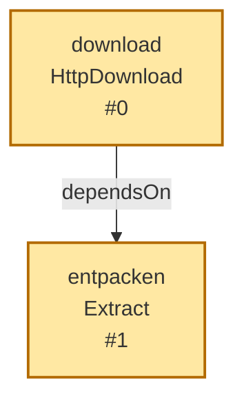
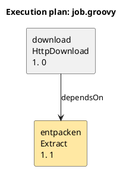

# Implementierte Runtimeverträge

Diese Seite beschreibt die gegenwärtige Implementierung. Öffentliche Signaturen
stehen in `gretl-api/src/main/java/ch/so/agi/gretl/runtime/api/`; fachliche
Operationsfelder stehen in der [Taskreferenz](../reference/reference.adoc).
[Module](module-boundaries.md),
[Paketierung](../guides/packaging.md) und
[Projekte](../guides/projects.md) haben eigene Anleitungen.

## Öffentliche Java-SPI

`OperationType<C,R>` ist die unveränderliche Operationsdefinition mit ID, Symbol,
Request-/Resultatklasse, Builder-/Handlerfabriken, Ein-/Ausgabemetadaten und Beispiel.
Fabriken liefern pro Invocation neue Instanzen. Die Definition hält keine Secrets,
offenen Streams oder Verbindungen. `Void`-Operationen besitzen keine Ausgänge.
`OperationProvider.operations()` liefert eine endliche Sammlung und öffnet weder
Fachverbindungen noch Engines und liest keine Secrets. Service Discovery verwendet
`META-INF/services/ch.so.agi.gretl.runtime.api.OperationProvider`.

`ConfigBuilder` validiert aufgelöste Werte in einen Request; der Handler erhält
`OperationContext`. Dieser bietet allgemeine Run-Dienste, Secretzugriff,
Cancellation, Budget, Ressourcen und Fortschritt. Er besitzt keine Vorgänger-
oder Joborchestrierung und benötigt keine Groovy-Typen.
`TaskContext` erweitert diesen Kontext um typisierten Ergebniszugriff,
`call(OperationType, validatedRequest)` für einen synchronen Aufruf und
`finishJob(reason)`. `result` und `resultOptional` benötigen deklarierte direkte
oder transitive Datenvorgänger. `CleanupContext` bietet nur `ContextView`,
Ressourcen und Abschlussbudget; er startet keine Tasks oder inneren Operationen.

`ContextView` stellt Identität, Parameter, Konfiguration, Job-/Start-/Workpfade,
Logger und Diagnosen bereit. Kontextzugriffe auf Parameter, Konfiguration und
Pfade nach Scope-Ende scheitern mit `CONTEXT_CLOSED`. `ResourceScope.manage`
registriert eigene `AutoCloseable`-Objekte. Ein Scope schliesst in umgekehrter
Registrierungsreihenfolge genau einmal; doppelte Objektidentität im selben
Scope ist unzulässig. Ergebnisse enthalten keine noch benötigten lebenden
Streams oder Verbindungen. Typ-/Feldmetadaten definieren lesende Ergebnisansichten;
Resultatobjekte werden nicht pauschal als Logs oder Berichte serialisiert.

Nachweise: `ApiRuntimeTypesTest`, `ApiMetadataTest`, `ApiIsolationTest`, die Runner-Kontext-/Ressourcentests sowie
`OperationMetadataTest`. Die ursprünglichen
[Operationsverträge](../../tests/contracts/operation-baseline.json) und
[Java-Typumzüge](../../tests/contracts/java-type-moves.json) bleiben dessen Orakel.
Sie werden bei Pfadumzügen nicht auf den aktuellen Ist-Code neu erzeugt.

## Definition, DSL und Planung

Groovy übersetzt Scripts in die Definition desselben Java-Runners. Registrierung,
späte Taskkonfiguration und Ausführung sind unterschiedliche Zeitpunkte.
Deklarierte Parameter und `taskConfig`-Aliase werden vor beziehungsweise beim
vorgesehenen Aufruf aufgelöst. Unbekannte Konfigurationsfelder sind Fehler.
`dependsOn` wählt echte Datenvorgänger; `after` ordnet nur schon ausgewählte
Tasks. `finalizedBy` wählt bedingte Abschlusskandidaten und aktiviert sie erst
nach einem erreichten Ownerabschluss. Siehe [Finalizervertrag](../guides/task-finalizers.md).
Ergebniszugriff erfordert weiterhin Datenabhängigkeit. Named Tasks,
Actions und synchrone innere Operationsaufrufe nutzen denselben Invoker.

Hilfe, Check und Planung führen keine Taskkonfiguration, Tasks oder Cleanups aus.
Vertrauenswürdiger Groovy-Top-Level-Code kann beim Definitionsladen dennoch laufen.
Dies ist keine allgemeine Sandbox für Jobcode. Settings sind dagegen deklarativ:
Der AST-Parser erlaubt konstante `include`-/`defaults`-Argumente und führt die
Settings nicht aus. Projekt- und Einzeldateimodus behalten ihre unterschiedlichen
Namens-/Pfadbasen; siehe [Subprojektvertrag](../guides/projects.md).

## Runner, Fehler und Abschluss

`SequentialJobRunner` arbeitet sequenziell und fail-fast. Ein Run besitzt seine
Identität, Workspaces und Ergebnisablage. Nach unbehandeltem Taskfehler laufen
normale Nachfolger nicht; aktivierte Finalizer werden unter ihren eigenen
Daten-/Ownerbarrieren abgearbeitet, danach folgen globale Cleanups.
Es gibt keinen automatischen Retry oder Resume.
Ein nicht-`Void`-Operationsergebnis darf nicht null sein und muss den deklarierten
Typ erfüllen. Actions dürfen ohne Wert normal enden. Optionale Ergebnisabfrage
ändert nicht die Abhängigkeitsprüfung.

Bei synchronem innerem Aufruf gelten normale Catch-Regeln: Eine bewusst
behandelte Fach-Exception kann innerhalb einer erfolgreichen Action liegen;
die fehlgeschlagene Invocation bleibt sichtbar. Weiterwerfen lässt die Action
scheitern. Cancellation und `finishJob` verwenden eigene Kontrollsignale und
sind keine pauschal als Erfolg zu verschluckenden Fachfehler. Insbesondere
Timeout-Präzedenz und zuerst beobachtete Kontrollursache bleiben durch
`RunControl`-/Budget-/Cancellation-Regressionen geschützt.

Ressourcenfreigabe und Jobcleanup gehören zum Abschluss. Ein sekundärer Close-
oder Cleanupfehler darf eine bereits vorhandene Primärursache nicht verdecken.
Ein solcher Fehler kann einen sonst erfolgreichen Abschluss scheitern lassen.
Die begrenzte Abschlusszeit, Shutdown-Behandlung, Report und Retention verwenden
dieselbe Job-Runtime für Script und JAR. Die Runtime verspricht kein Rollback
bereits geschehener fachlicher Wirkungen und keine Transaktion über Tasks hinweg.
Exitcodes und Status sind im [CLI-/Betriebsteil der Referenz](../reference/reference.adoc)
und den bestehenden CLI-/Jobprozess-Tests definiert; diese Bereinigung ändert sie nicht.

## Logging, Sicherheit und Pfade

Verwaltete Senken teilen Identität, Sequenz und Secretredaktion. Run-, Task-,
Invocation- und Cleanup-Scopes ordnen Bibliothekslogs lexikalisch zu.
`LibraryScopeLocalJobIT` prüft diese Zuordnung; Cancellation- und Sicherheitsjobs
prüfen frühe Setupfehler, ursprüngliche Ursachen und Abschlussberichte.
Diagnostik und Ereignisdateien sind privat; Loggergrenzen, sichere strukturierte
Fehlerdetails und begrenzte Dateien bleiben bestehen. Bekannte Secrets und
`sensitive`-Werte werden registriert und sensible Feldnamen gefiltert.
Das ist keine Garantie für beliebige selbst implementierte Ausgabekanäle eines Jobs.

Heartbeat-/Progressintervalle werden konfiguriert und validiert; ein periodischer
Heartbeat-Timer oder Progress-Koaleszenz ist nicht implementiert. Ein eigener
OpenTelemetry-Export gehört nicht zum gelieferten Laufzeitumfang.

Vorhandene Workspace-Roots und Eltern behalten ihre Rechte; neue Runbereiche
werden exklusiv besessen, auf POSIX privat angelegt und vor Nutzung/Retention
geprüft. Symlink-/Traversal- und Ownership-Regeln werden nicht durch kosmetische
Bereinigung ersetzt. Plattformtests prüfen auch Nicht-POSIX-Fallbacks und echte
Linux-Zugriffe mit unprivilegierter UID. `workPath` bleibt im jeweiligen Scope.

Secretaliasse haben unter Konfigurationsschema 1 genau eine Quelle:
`environment`, `file` oder `plaintext`. Es gibt keinen automatischen Fallback.
Klartextwerte in einer Konfiguration werden nicht durch spätere Logmaskierung
verschlüsselt. Datei-/Wertgrenzen und Pfadbasen stehen in der
[Build-/Betriebsanleitung](../development/build.md).

Jobressourcen sind explizit. Ein paketierter Job materialisiert sie rungebunden;
Modellverzeichnisse werden ausdrücklich angegeben. Tagesdaten und dauerhafte
Fachausgaben werden nicht automatisch ins JAR aufgenommen. Eigene Fachbibliotheken
besitzen ihre eigenen Verbindungen und Transaktionen. Ein künftiger Publisher
bekommt dafür keine Sonderregistry und keinen verdeckten Hostkoordinator.

## Lokalisierung

**Status:** Implementiert. Englisch ist Quell- und Fallback-Sprache;
Deutsch wird zusätzlich ausgeliefert.

### Sprachen

- **Englisch** ist die Quell- und Fallback-Sprache.
- **Deutsch** wird als zusätzliche Sprache in der Distribution ausgeliefert.
- Technische Werte wie `event_name`, Diagnosecodes, Feldnamen und IDs bleiben
  sprachneutral.

### Kataloge

`gretl-i18n` enthält:

```text
ch/so/agi/gretl/i18n/messages.properties       Englisch (Quelle)
ch/so/agi/gretl/i18n/messages_de.properties    Deutsch
```

Die Katalogparität wird getestet. Ein nicht unterstütztes Locale fällt auf
Englisch zurück.

### Sprachwahl

Implementierte Priorität:

```text
--lang <en|de>  >  GRETL_LANGUAGE  >  language in runtime.json
  >  OS-Locale  >  Englisch
```

`language` ist ein optionales Feld der Runtimekonfiguration. Ein nicht
unterstützter Wert wird abgelehnt. Deutsch wird bei einer deutschen
OS-Locale automatisch gewählt; sonst gilt Englisch. Die CLI- und Job-JAR-Pfade
verwenden diese Auflösung. Interne Bibliotheks-Defaults bleiben für
Einbettungstests explizit deutsch, sofern kein Kontext übergeben wird.

### Abgedeckte Bereiche

- Event-Titel und Framework-Labels im Textformatter,
- globale CLI-Hilfe und Hilfeüberschriften,
- Task-Kurzbeschreibungen und Task-/Feldbeschreibungen der Standardtasks in
  `operations`,
- strukturierter Fehlerblock (`Code`, `Task`, `Field`, `Allowed fields`,
  `Message`, `Source`, `Cause`),
- die Meldung für unbekannte Task-Konfigurationsfelder
  (`Unknown configuration field ...`),
- CLI-Options- und Aufruffehler (`CliOptions`),
- Top-Level-Fehler von Runtimekonfiguration und Parameterdatei,
- Package-/Check-Ausgaben und weitere CLI-Laufzeitfehler,
- Parameterfehler des Runners (`ParameterResolver`),
- Detailfehler der Runtimekonfiguration (Logging, Secrets, TaskConfig),
- strukturierte Codes der Standard-Task-Exceptions (`HTTP_*`, `SQL_*`,
  `EXTRACT_*`, `ILIVALIDATOR_*`),
- Task-Meldungen von HttpDownload, Extract, SqlExecutor und IliValidator,
- Groovy-Loader-, DSL-, Scope- und ResultView-Meldungen,
- Registry-, Definition- und Provider-Contract-Fehler des Runners,
- Startup-, Metadaten- und Ressourcenfehler des gepackten Job-JARs,
- Packager-Meldungen (Deskriptor, Kompilierung, JAR-Bau),
- englische Formatter-/CLI-Golden-Tests.

### Grenzen

- Eigene Task-Bibliotheken verwenden ihre eigenen Meldungen und können einen
  eigenen Katalog mitbringen; ohne Katalog bleiben sie englisch.
- Interne Bibliotheks-Defaults verwenden für Einbettungstests Deutsch, wenn
  kein Locale-Kontext übergeben wird. CLI, Job-JAR und Runner übergeben die
  aufgelöste Locale explizit.

### Diagnose

Fehler tragen strukturierte Werte getrennt von der Meldung:

```text
Code: UNKNOWN_CONFIGURATION_FIELD
Task: bad
Field: unknownSetting
Allowed fields: url, output, ...
Source: job.groovy:2
```

Die Textdarstellung rekonstruiert diese Werte nicht mehr per Regex. JSON und
Runbericht enthalten dieselben Metadaten.

## Plangraphen

`gretl plan` kann den ausgewählten DAG als Mermaid- oder PlantUML-Quelltext
ausgeben. Die Runtime rendert bewusst keine Bilder und startet keinen
externen Dienst; die Ausgabe kann in GitHub, IDEs, Markdown oder mit einem
lokalen PlantUML-Werkzeug dargestellt werden.

### Aufrufe

```sh
## Mermaid nach stdout
gretl plan job.groovy --graph mermaid

## PlantUML in eine Datei
gretl plan job.groovy --graph plantuml --output plan.puml

## Nur den ausgewählten Teilgraph
gretl plan job.groovy --target entpacken --graph mermaid
```

Ohne `--graph` bleibt die bisherige Textausgabe von `gretl plan` unverändert.
`--output` ist bei `plan` nur zusammen mit `--graph` zulässig.

### Mermaid



- Durchgezogene Kante: `dependsOn`, echte Datenabhängigkeit.
- Gestrichelte Kante: `after`, nur Reihenfolge.
- Hervorgehobene Owner-zu-Finalizer-Kante: `finalizedBy`, bedingte Abschlussarbeit.
- Farbig markiert: angeforderte Ziele.

### PlantUML



Die Ausgabe ist reiner Quelltext. PlantUML wird nicht als JAR eingebettet und
Mermaid wird nicht über einen Netzwerkdienst gerendert.

### Grenzen

- Es wird nur der ausgewählte Plan gezeigt; nicht ausgewählte Tasks fehlen.
- Es gibt keine Bild-, PNG- oder SVG-Ausgabe.
- Die Graphausgabe ist ein Planungsartefakt; Task-Closures werden nicht
  ausgeführt und es entstehen keine Work-/Report-Verzeichnisse. Vertrauenswürdiger
  Groovy-Top-Level-Code kann beim Laden der Definition ausgeführt werden.
- Die technischen Kantenlabels `dependsOn`, `after` und `finalizedBy` bleiben
  sprachneutral; Titel und Fehlermeldungen folgen der Locale.

## Funktionsgrenzen

Die Distribution enthält keine Operationen `Publisher` oder `XtfToGpkg`.
Die vorhandenen `Ili2gpkg`-Operationen haben eigene Verträge in der
[Taskreferenz](../reference/reference.adoc). Runtime und Job-JARs benötigen
Java 25; ein Native Image wird nicht ausgeliefert.
