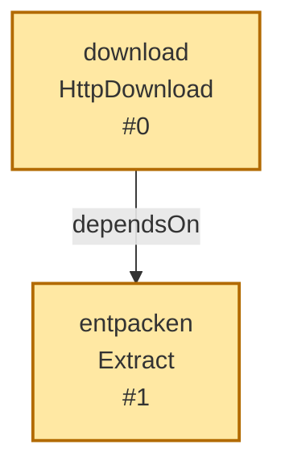
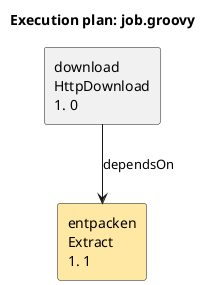

# DAG-Visualisierung für `gretl plan`

`gretl plan` kann den ausgewählten DAG als Mermaid- oder PlantUML-Quelltext
ausgeben. Die Runtime rendert bewusst keine Bilder und startet keinen
externen Dienst; die Ausgabe kann in GitHub, IDEs, Markdown oder mit einem
lokalen PlantUML-Werkzeug dargestellt werden.

## Aufrufe

```sh
# Mermaid nach stdout
gretl plan job.groovy --graph mermaid

# PlantUML in eine Datei
gretl plan job.groovy --graph plantuml --output plan.puml

# Nur den ausgewählten Teilgraph
gretl plan job.groovy --target entpacken --graph mermaid
```

Ohne `--graph` bleibt die bisherige Textausgabe von `gretl plan` unverändert.
`--output` ist bei `plan` nur zusammen mit `--graph` zulässig.

## Mermaid



- Durchgezogene Kante: `dependsOn`, echte Datenabhängigkeit.
- Gestrichelte Kante: `after`, nur Reihenfolge.
- Farbig markiert: angeforderte Ziele.

## PlantUML



Die Ausgabe ist reiner Quelltext. PlantUML wird nicht als JAR eingebettet und
Mermaid wird nicht über einen Netzwerkdienst gerendert.

## Grenzen

- Es wird nur der ausgewählte Plan gezeigt; nicht ausgewählte Tasks fehlen.
- Es gibt keine Bild-, PNG- oder SVG-Ausgabe.
- Die Graphausgabe ist ein Planungsartefakt; Task-Closures werden nicht
  ausgeführt und es entstehen keine Work-/Report-Verzeichnisse.
- Die technischen Kantenlabels `dependsOn` und `after` bleiben
  sprachneutral; Titel und Fehlermeldungen folgen der Locale.
