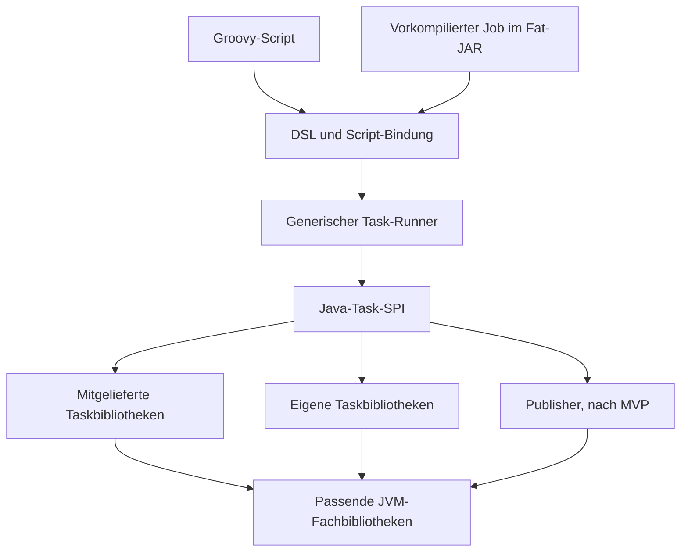

# 01 — Strategisches Zielbild und MVP

**Status:** Spezifikationsvorschlag 4.1, 18. Oktober 2026.  
**Normativ für:** Produktziel, Architekturgrenzen und Lieferumfang.  
**Produkt:** GRETL; neues Repository `gretl-runtime`. „GRETL Light“ bleibt die Bezeichnung des früheren Entwurfs, nicht eine andere Laufzeit.

## Verbindliche technische Ergänzung in Version 4.0

Die neue Spezifikation legt die öffentliche SPI vollständig in [14 — Java-API](14-java-api-vertraege.md) fest. [15 — Runner-Klassendesign](15-runner-klassendesign.md) ordnet die Kernverantwortlichkeiten konkreten Klassen und Methoden zu. [16 — Logging und Telemetrie](16-logging-und-telemetrie.md) ist ein **MVP-Vertrag**, kein unverbindlicher späterer Betriebshinweis. Die Abschlussprüfung gegen die Findings steht in [17](17-findings-und-pruefprotokoll.md).

Die Liefergrenzen bleiben unverändert: A+B ergeben den Script-MVP; C ist der optionale Job-Packager. Publisher und XtfToGpkg bleiben ausserhalb der MVP-Implementierung und -Auslieferung. Echte OpenTelemetry-Exporter, Collectorinstallation, Metrikserver und Native Image werden nicht zur neuen Voraussetzung. Die Fachanwender-DSL bleibt bei `=`-Zuweisungen, benannten Tasks und späten Werten.

Eine begrenzte Präzisierung betrifft fehlende Ergebnisse: Actions dürfen null liefern, explizite Void-Operationen ebenfalls. Ein nicht-Void-Handler mit deklarierter Ergebnisstruktur darf nicht unbemerkt null liefern; dies ist jetzt ein Providervertragsfehler. Die alten pauschalen Handler-null-Aussagen werden entsprechend ersetzt. Der Ergebnisstore trennt Wertpräsenz weiterhin vom Taskstatus.


## 1. Ziel

GRETL Light ist eine kleine JVM-Runtime für datenverarbeitende Jobs. Fachanwender sollen vorhandene Aufgabenbausteine zu verständlichen Jobs verbinden und deren Einstellungen ändern können, ohne die Interna von Java, Groovy oder Gradle zu kennen. Entwickler können zusätzliche Facharbeit in selbst programmierbaren JVM-Tasks kapseln. Für anspruchsvollere Joblogik bleibt gewöhnlicher Groovy-Code verfügbar.

Der Nutzen liegt in einer einfachen Ausführungssemantik und einer kleineren Abhängigkeit vom Gradle-Projektmodell. Ein neuer DAG-Algorithmus ist keine wesentliche Produktleistung. Entscheidend sind die Auswertungszeitpunkte, die Verbindung von normalem Code und Tasks, verständliche Fehler sowie die Wiederverwendung der bestehenden Fachbibliotheken.

### STR-001 — Normaler Jobbetrieb ohne vorgängigen Build

Ein geänderter Job muss mit einer bereits ausgelieferten Runtime direkt ausführbar sein:

```sh
gretl run jobs/neophyten/job.groovy --param sourceUrl=https://example.invalid/data
```

Die interne Übersetzung des Groovy-Scripts zu Bytecode beim Laden gehört zum automatischen Startvorgang. Der Jobautor führt dafür weder Maven noch Gradle aus und baut kein neues Runtimeimage.

Ein ausdrücklich angefordertes Job-Fat-JAR ist eine zusätzliche Auslieferungsform. Dass dieser optionale Paketierungsweg einen Build enthält, ändert den Standardvertrag nicht. Wiederverwendbare Java-Taskbibliotheken benötigen wie bisher ihren eigenen normalen Bibliotheksbuild.

### STR-002 — Gradlefreie Laufzeit

Die öffentliche SPI und der Ausführungspfad enthalten keine Gradle-API. Ein bestehender Job wird nicht verdeckt an Gradle weitergereicht. Alte Klassen mit `DefaultTask`, `Project`, `Property` oder `ListProperty` sind nicht die neue Task-SPI.

Maven baut das Runtimeprodukt und seine Bibliotheken. Die Werkzeugwahl ist bestätigt. Der Produktbuild bleibt konventionell: ein eigener Parent, kleine Modul-POMs und nur konkret begründete zusätzliche Plugins oder Profile; kein internes Buildframework. Der verbindliche Vertrag BLD-001 bis BLD-008 steht in [07, Abschnitt 6.4](07-plattform-und-versionen.md#64-verbindliche-leitlinie-konventioneller-maven-produktbuild). Der ausgelieferte Script-Runner und ein fertiges Job-Fat-JAR benötigen weder Maven noch Gradle. Ein optional installierter Packager darf Maven beim expliziten Paketbuild verwenden.

### STR-003 — Kein Buildsystem im Jobkern

Nicht vorgesehen sind Taskcache, Up-to-date-Prüfung, Konfigurationscache, Taskinput-Fingerprints, inkrementelle Wiederverwendung und automatische Fortsetzung eines vergangenen Runs.

Ein Job darf selbstverständlich Dateien erzeugen, Datenbanken verändern und Fachzustand speichern. Ein Publisher darf Historie führen. Diese Daten gehören dem Job oder der Taskbibliothek; sie sind kein allgemeiner Runtimecache. Ergebnisse eines laufenden Jobs bleiben bis zu dessen Ende zugänglich.

### STR-004 — Einfache Grundform für Fachanwender

Die Grundform der DSL verwendet benannte Schritte, lesbare Einstellungen mit `name = wert`, ausdrücklich benannte Abhängigkeiten sowie kleine Hilfen für Parameter, Dateien und Ergebnisse. Ein einfacher Job verlangt weder `def` für jeden Schritt noch TaskRef-Verwaltung, einen expliziten Contextparameter oder Kenntnisse von Buildern und Providern. Die nötigen fachlichen Einstellungen bleiben sichtbar; die DSL errät keine Ausführungsreihenfolge aus Dateinamen oder später gelesenen Ergebnissen.

Jobparameter erhalten eine einfache Deklaration mit Name, Typ, Beschreibung, Pflichtangabe und gegebenenfalls Default. Verständliche Hilfe und frühe Meldungen über fehlende oder falsch geschriebene Angaben gehören zur MVP-Oberfläche. Scriptstart und Job-JAR verwenden dieselben Parameterregeln. Ein zweites konkurrierendes Parameterschema nur für Paketierung ist nicht vorgesehen.

Die Einführung zeigt zuerst kurze lauffähige Beispiele mit vorhandenen Tasktypen. Schleifen, Actions und eigener Java-Code folgen als vertiefende Möglichkeiten. Eine fachlich anspruchsvolle Transformation wird dadurch nicht automatisch ohne Fachkenntnisse bedienbar; häufig benötigte Programmierdetails sollen in wiederverwendbaren Aufgabenbausteinen gekapselt werden. Die genauen Verträge stehen in [04](04-job-dsl-und-custom-tasks.md) und [06](06-betrieb-und-auslieferung.md).

## 2. Die richtige Grenze aus dem Publisher-Audit

### STR-010 — Fachliche Komplexität ist kein eigener Runtime-Typ

Der Publisher enthält Auswahl, Validierung, Konvertierung, Dateilayout, Historie und externe Metadatenarbeit. SqlExecutor besitzt Transaktionen und SQL-spezifische Fehlerfälle. Beide sind gewöhnliche Custom-Tasks.

Der Runner muss einen komplexen Task zuverlässig aufrufen können. Er muss dessen internes Fachmodell weder kennen noch in seine öffentliche Architektur übernehmen.

| Verantwortung | Eigentümer |
|---|---|
| Tasknamen, Abhängigkeiten, Ausführungsplan | Runtime |
| Zeitpunkt der Konfiguration, Resultatzugriff | Runtime und DSL |
| Logger, Arbeitsbereich, Cancellation, allgemeiner Fehlerbericht | Runtime |
| SQL-Transaktion und Datenbankausgang | SqlExecutor |
| Regionen, Modelle, Formate und Publikationslayout | Publisher |
| Erfolg trotz optional fehlgeschlagener Nacharbeit oder Fehler bei erforderlicher Nacharbeit | Jeweiliger Custom-Task beziehungsweise ausdrücklich behandelnder Jobcode |
| Fachlicher Wiederanlauf, Idempotenz, Historie und allfälliger Abgleich | Jeweiliger Custom-Task / Fachanwendung |
| Allgemeine Parameterübergabe und Jobpaketierung | CLI / Packager |

Der Core besitzt keine Publikationsgeneration, keinen Commitpointer, keinen Metadatenzustellungsstatus und keine zentrale offene Pflicht. Insbesondere gibt es keine Publisherbefehle oder exklusiven Publisher-Exitcodes.

### STR-011 — Fehler und Seiteneffekte

Ein unbehandelter Fehler lässt den umgebenden Task fehlschlagen. Ein bewusst gefangener und behandelter Fachfehler darf nach normalen Groovy-/Java-Regeln zu einem erfolgreichen Action-Task führen. Die Runtime führt keinen fachlichen Gegenentscheid aus.

Ein erfolgreicher Taskabschluss bedeutet, dass sein definierter Ablauf erfolgreich zurückgekehrt ist. Ein fehlgeschlagener Task bedeutet nicht, dass alle bisherigen Seiteneffekte verschwunden sind. Ein Custom-Task kann teilweise erfolgreich gearbeitet haben und danach scheitern. Er muss solche wichtigen Tatsachen in seiner eigenen Fehlerdiagnose mitteilen können.

Daraus folgt ein generischer Diagnosekanal, aber kein generisches Transaktions-, Saga-, Outbox- oder Reparatursystem. Ein Wartungsjob darf später dieselbe normale Custom-Task-SPI verwenden; dafür braucht es keine CLI-Erweiterung.

### STR-012 — Publisher bleibt wichtig; seine Lieferung folgt nach dem MVP

Die Umsetzung und Bereitstellung des Publishers gehören nicht zum MVP. Es werden weder ein Publisher-Handler oder Platzhalter registriert noch ein Publisher-Artefakt oder ausschliesslich dafür benötigte Abhängigkeiten ausgeliefert. Ein Publisher-End-to-end-Test ist kein Freigabekriterium für A, B oder C.

Die vollständige Bestandsanalyse, die daraus gewonnenen allgemeinen Runtime-Regeln und der fachliche Zielvertrag bleiben erhalten. [Kapitel 05](05-publisher-zielvertrag.md) beschreibt den ersten begrenzten Publisher-Port als eigenständigen Liefermeilenstein nach dem MVP. Seine spätere Abnahme prüft reale Fixtures. Die allgemeinen Erkenntnisse zu Ergebnissen, Fehlern, Teilwirkungen und Ressourcen werden bereits im MVP mit unabhängigen Tasks sowie realen SQL- und INTERLIS-Pfaden nachgewiesen.

Publisher-Port und fachlicher Publisher-Neuentwurf sind weiterhin verschiedene Vorhaben. Der Port verlangt keinen neuen Publikationsspeicher und kein neues Metadatenprotokoll. Weitere Verbesserungen werden in der Taskbibliothek entwickelt und unabhängig abgenommen. Wegen seiner Bedeutung ist eine spätere Aufnahme in die Standarddistribution ausdrücklich vorgesehen; dafür entsteht keine besondere Rolle im Runner. Der Publisher-Meilenstein ist unabhängig von Job-Fat-JAR und Native Image und muss auf deren Umsetzung nicht warten.

## 3. Architektur



Das Diagramm zeigt den strategischen Überbau einschliesslich des späteren Publishers. Alle Taskbibliotheken verwenden dieselbe SPI. Interne Bibliotheksfunktionen müssen deshalb nicht als öffentliche Runtimeoperationen registriert werden. Die GeoTools-Qualifikation des MVP ist eine gesonderte Entwicklungs-/CI-Probe und kein zusätzlicher öffentlicher Tasktyp. Ihre Testabhängigkeiten vergrössern nicht allein deshalb den Runtime-Lieferbestand.

### STR-020 — Kleine Module, ein Prozess zuerst

Die logischen Schichten sind API, Runner, Groovy-Adapter, CLI und Taskbibliotheken. Der optionale Packager ist ein eigenes Entwicklungswerkzeug. Ein Maven-Modul kann mehrere eng zusammengehörige Hilfskomponenten enthalten; es ist kein Selbstzweck, für jeden Record ein Artefakt zu erzeugen.

Der MVP führt einen Job in einer frischen JVM sequenziell aus. Die gemeinsam verwendeten Bibliotheken werden als konkrete Zusammenstellung qualifiziert. Ein separates Modul ist keine Classloader-Isolation.

Wenn eine Bibliothek nachweislich einen anderen JDK-Stand, inkompatible Versionen oder eine stärkere Prozessgrenze braucht, kann ein gezielter Adapter einen separaten Prozess verwenden. Daraus entsteht keine allgemeine Workerplattform im MVP. Es gibt keinen hypothetischen Zwang, jeden Task zuerst in transportierbare DTOs zu zerlegen.

### STR-021 — Eine Ausführungssemantik, unterschiedliche Einstiegstiefen

Ein typisierter Task erhält seine mit Einstellungen beschriebene Konfiguration beim Start, nachdem seine Vorgänger abgeschlossen sind. Laufzeitparameter und `result('schritt')` stehen dort über dieselbe Grundoberfläche zur Verfügung. Diese Grundform genügt für Jobs, die vorhandene Aufgabenbausteine konfigurieren und verbinden.

Eine Action ist die vertiefende Form für normalen ausführbaren Groovy-Code. Sie darf Tasks synchron aufrufen und deren Resultate weiterverarbeiten; dafür bleibt bei Bedarf der explizite Context mit `ctx.run(...)` zugänglich. Beide Formen verwenden denselben Plan, dieselben Ergebnisse und dieselben Regeln für Fehler und Abbruch. Eine vereinfachte Grundform erzeugt kein zweites Ablaufmodell.

Damit verschwinden zusätzliche `doFirst`-/`doLast`-Listen aus der neuen API. Die notwendige fachliche Vor- und Nacharbeit bleibt bestehen und bekommt eine klare Stelle im Code. Nicht jeder bestehende Hook lässt sich durch blosses Umbenennen korrekt migrieren.

### STR-022 — Strategische Erweiterbarkeit ohne Vorabimplementierung

Stabile Grenzen sind die Groovy-Joboberfläche, die Java-SPI und die gemeinsame Runsemantik. Nicht festgelegt werden zukünftige Datenbank- oder Publikationsmodelle, ein universelles Workerprotokoll oder beliebige Pluginversionen im selben Classloader.

Spätere Parallelität, weitere DSLs oder ein Jobserver erfordern zusätzliche Verträge. Die sequenzielle MVP-Semantik darf dafür nicht bereits implizite falsche Zusagen enthalten: Ergebnisse verlangen explizite Abhängigkeiten, Cancellation ist kooperativ und ein Side effect ist kein automatisch rückgängig machbarer Taskinput.

### STR-023 — Offener, releasebezogener Taskkatalog

Die Standarddistribution enthält den für ihre Releaseversion dokumentierten und geprüften Taskkatalog. Die darin angebotenen Tasktypen stehen ohne zusätzliche Imports oder Installationsschritte im Job bereit. Eine Aufzählung beschreibt den Lieferumfang dieses Releases, keine geschlossene Menge aller zukünftigen GRETL-Tasks.

Weitere von GRETL gepflegte Tasks können regulär in spätere Standarddistributionen aufgenommen werden. Organisationsspezifische Bibliotheken können ebenfalls in die gemeinsam ausgelieferte Distribution beziehungsweise ein Containerimage aufgenommen werden. Mitgelieferte und eigene Tasktypen verwenden dieselbe SPI, Registrierung, DSL und Fehlersemantik. „Custom-Task“ bedeutet nicht, dass jeder Anwender den Baustein selbst programmieren oder separat installieren muss.

Entwickler und Betriebsverantwortliche stellen den qualifizierten Bibliotheksbestand vor dem Jobstart bereit. Der Anwender erhält eine benutzbare Zusammenstellung. Kapitel 06 unterscheidet dafür `lib/tasks` als kuratierten Releasebestand und `lib/extensions` für zusätzlich bereitgestellte Bibliotheken samt passenden Dependencies. Diese Verzeichnisse sind keine Classloader-Isolation. Die Standarddistribution erfordert keine Laufzeitauflösung über Maven, Gradle oder Grape.

| Tasktyp beziehungsweise Nachweis | Zusage dieses Vorhabens |
|---|---|
| `HttpDownload` | Mitgelieferter Tasktyp in MVP-A. |
| `Extract` | Mitgelieferter Tasktyp in MVP-A. |
| `SqlExecutor` | Mitgelieferter Tasktyp in MVP-A mit begrenztem PostgreSQL-Vertrag. |
| `IliValidator` | Mitgelieferter Tasktyp in MVP-B mit lokaler Modellkompilation und Validierung. |
| GeoTools-Probe | Kleine verbindliche Entwicklungs-/CI-Kompatibilitätsprobe in M0/B mit ausgewiesenem Testbestand; kein öffentlicher Standardtask und kein allein dadurch begründeter Runtimebestand. |
| `XtfToGpkg` | Spätere unabhängige Formatoperation nach dem MVP; vor Lieferung sind Request, Ergebnis, Fachtests und Enginebestand festzulegen. |
| `Publisher` | Strategisch wichtiger Tasktyp nach dem MVP; der erhaltene Zielvertrag steht in Kapitel 05. |

Die Kataloganzeige der Runtime listet nur implementierte und vorhandene Tasktypen. Für später spezifizierte Namen werden keine ausführbaren Stubs registriert. Ein fehlender Tasktyp und ein Namenskonflikt ergeben verständliche Meldungen. Ein Job-Fat-JAR enthält seinen ausdrücklich gewählten Bibliotheksbestand; es muss weder den vollständigen Standardkatalog noch einen späteren Publisher pauschal mitnehmen.

Die Standarddistribution enthält die tatsächlich benötigten Laufzeitabhängigkeiten ihrer angebotenen Tasks. Die vorbereitende GeoTools-Probe verwendet ein gesondertes Testprofil mit derselben JDK-/Groovy-/Runtimebasis und ausdrücklich zusätzlich ausgewiesenen GeoTools-Modulen samt nötigen Dependencies. Daraus folgt keine Pflicht, unbenutzte GeoTools-Bibliotheken mitzuliefern. Falls ein tatsächlich angebotener Task GeoTools direkt oder transitiv benötigt, gehört dieser Bestand selbstverständlich in seine Distribution und in die passenden Paketprüfungen. Kapitel 07 trennt diese Nachweise.

## 4. Lieferstufen

### MVP-A — Allgemeine Jobruntime

Pflichtumfang:

- Script laden, Registrierung einfrieren, Ziele und Abhängigkeiten planen.
- Statischer sequenzieller DAG mit `dependsOn`, reiner Reihenfolge `after` und Standardzielen.
- Spät konfigurierte Tasks, Actions, synchrone Fachaufrufe und Resultate.
- Optionale Ausführung, ausdrückliches erfolgreiches Jobende bei fehlenden Daten, Fail-fast und Cleanup.
- Allgemeine CLI, deklarierte Parameter mit verständlicher Hilfe und Prüfung, Secrets, Arbeitsbereiche und strukturierter Runbericht.
- Öffentliche Java-SPI und eine separat gebaute Beispielerweiterung.
- Reale HTTP-, Archiv- und PostgreSQL-Operationen mit ihren begrenzten dokumentierten Verträgen.
- Direkte Ausführung der wesentlichen Hookmuster aus den untersuchten Jobs anhand lokaler Fixtures.

A ist eigenständig nutzbar und wird unabhängig vom Publisher angenommen oder verworfen. Ein künstlicher Task mit 30 Zeilen kann die Erweiterungsmechanik beweisen; die realen Bibliothekspfade werden zusätzlich benötigt.

### MVP-B — Bestehende Fachlogik integrieren

Pflichtumfang für die zusammen mit A als GRETL-Script-MVP bezeichnete Gesamtausgabe:

- Der reale `IliValidator`-Task mit INTERLIS-Modellkompilation und Validierung an einer kleinen, festgelegten Modellmenge.
- Kleine reale GeoTools-Kompatibilitätsprobe in einem gesonderten Entwicklungs-/CI-Testprofil, inklusive Provider-/CRS-Prüfung auf der festgelegten JDK-/Groovy-/Runtimebasis und mit vollständig ausgewiesenem zusätzlichen GeoTools-Bestand.
- Prüfung von Ressourcenfreigabe, Laufzeitfehlern und bibliotheksbedingten Konflikten in der gewählten Distribution.

B ist ein Integrationsnachweis ohne Publisher-Code, -Registrierung, -Artefakt oder ausschliesslich publisherbedingte Dependencies. Die GeoTools-Probe registriert keinen öffentlichen Format- oder Publisher-Task und erzwingt keine unbenutzten GeoTools-JARs in der Standarddistribution. Sie belegt die konkrete geprüfte Kombination als Vorbereitung für spätere Fähigkeiten, keinen Publisher-Port und keine bereits gelieferte GeoTools-Fachfunktion. Weder XtfToGpkg noch SHP/DXF-Tasks, SFTP, DB-Export oder produktive SIMI-Anbindung werden dadurch zum Lieferumfang. Bestehende fachliche Risiken und die späteren Publisher-Verträge bleiben dokumentiert.

### Paketierung-C — Optionales Job-Fat-JAR

C ist die unmittelbar anschliessende, unabhängig freigebbare Auslieferungsfunktion. Sie wird vollständig spezifiziert, blockiert aber nicht die Nutzung von A und B.

Ein expliziter Paketbuild fixiert Jobcode, Runtime, Taskbibliotheken und deklarierte Ressourcen. Groovy wird dabei automatisch zu normalem JVM-Bytecode vorkompiliert. Der fertige Job startet mit `java -jar`, erhält Parameter und Secrets erst bei der Ausführung und benötigt kein installiertes GRETL.

Der Build führt die ETL nicht aus. C enthält keine allgemeine statische Analyse beliebiger Groovy-Programme und kein automatisches Erraten ihrer Abhängigkeiten. Kapitel 12 ist für diesen Vertrag massgeblich.

### Nach dem MVP — Publisher und weiterer Taskkatalog

Der begrenzte Publisher-Port aus Kapitel 05 wird nach seiner fachlichen Priorität separat umgesetzt, getestet und ausgeliefert. Seine Umsetzung muss nicht auf C oder einen Native-Versuch warten. Weitere bisherige GRETL-Tasks und eine unabhängige XtfToGpkg-Operation erhalten ebenso eigene begrenzte Lieferverträge und können den regulären Standardkatalog erweitern.

### Später — Native

Native Image eines ausgewählten festen Jobs wird erst nach einem brauchbaren Job-Fat-JAR und einem konkreten Nutzen geprüft. Es ist kein Abnahmekriterium für A, B oder C. Ein schneller Launcher allein beweist keine schnellere Jobausführung.

## 5. Explizite Nichtziele

Der MVP enthält keine vollständige Gradle-Kompatibilität, keinen Buildcache, keine verteilte Ausführung, keinen Schedulerdienst, keinen Mandantenserver, kein Hot-reload von Taskbibliotheken, keine automatische Mavenauflösung zur Joblaufzeit, keine obligatorische Native-Kompilation und keine automatische Migration aller Jobs.

Er enthält keine Publisher-Implementierung oder -Bereitstellung, keine eigene Publisher-CLI, keinen zentralen Publikationsstore und keine fachliche Selbstheilung. Die Publisher-Spezifikation bleibt als späterer Modulauftrag erhalten. Der Runner garantiert keine Rückabwicklung nach einem Taskfehler und keine sichere Sandbox für beliebigen vertrauenswürdigen Groovy-Code.

Diese Grenzen verhindern nicht, dass eine Taskbibliothek aufwändige Business-Logik besitzt. Genau diese Möglichkeit gehört zum Produktziel.

## 6. Referenzszenarien und Erfolgsmassstab

| Szenario | Nachweis |
|---|---|
| Token lesen, Katalog laden, URL auswählen | Werte entstehen im laufenden Job und konfigurieren spätere Tasks. |
| Datei laden, umcodieren, prüfen | Vorarbeit, Aufruf und Nacharbeit haben einen gemeinsamen klaren Erfolgsumfang. |
| Liste ist leer | Explizites erfolgreiches Jobende; Transportfehler bleiben Fehler. |
| Eigener Java-Task aus zusätzlichem JAR | Erweiterbarkeit ohne Änderung des Runners und ohne Gradle. |
| SQL-Operation scheitert | Normale Fehlerkette und Adapterdiagnose, kein automatischer Vollretry. |
| Fachanwender konfiguriert einen Beispieljob | Benannte Schritte, Einstellungen, Dateien und Parameter sind ohne Context-/Builderkenntnisse benutzbar; Fehler nennen die betreffende Angabe. |
| IliValidator mit lokalem Modell und XTF | Tatsächliche Fachbibliotheksintegration über dieselbe SPI. |
| Optionales Job-Fat-JAR mit anderem Arbeitsverzeichnis | Eigenständiger Start, enthaltene Ressourcen und externe Laufzeitparameter funktionieren. |

Der spätere Publisher mit realem XTF ergänzt diese Nachweise beim eigenen Modulmeilenstein. Seine im Audit dokumentierten Anforderungen bleiben ein Prüfstein der Architektur, ohne seine Implementierung zum MVP-Gate zu machen.

Eine gute DSL-Demo genügt nicht. Kapitel 09 definiert die konkreten Abnahmekriterien und trennt den MVP von späteren Publisher-Tests; Kapitel 10 legt die Umsetzungsreihenfolge fest.
